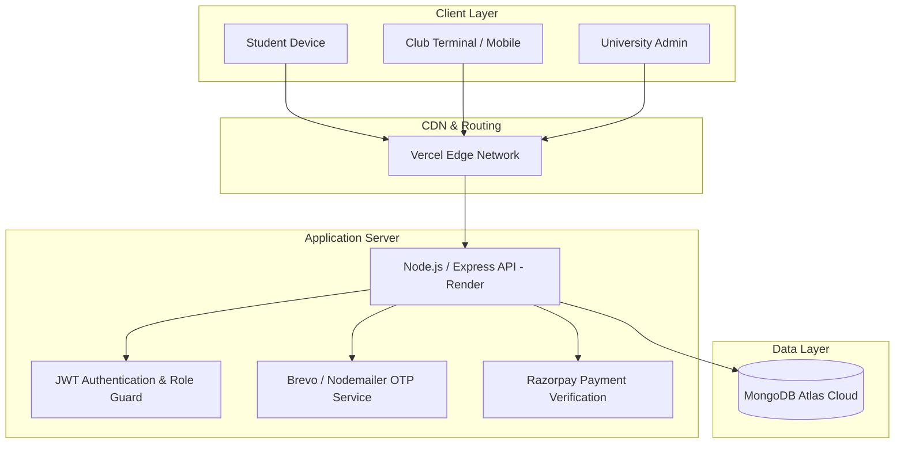
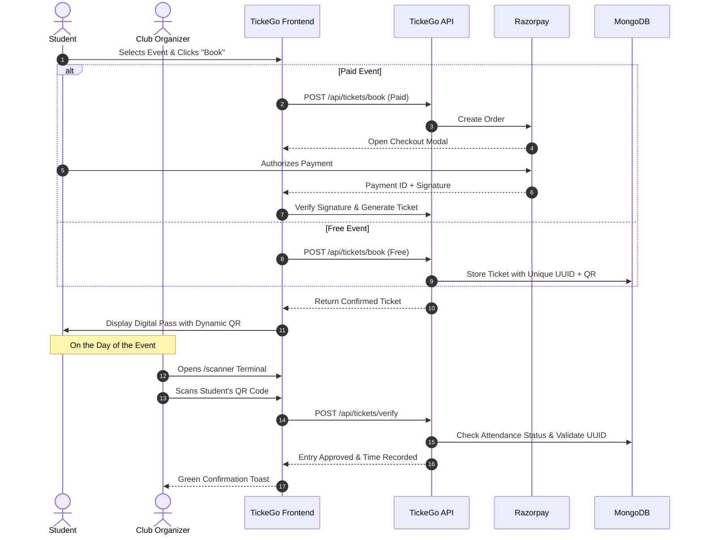

# 🎟️ TickeGo — Next-Gen Campus Event & Smart Ticketing Platform

<div align="center">

[](https://tickego.vercel.app)
[](https://tickego.onrender.com)
[](https://react.dev/)
[](https://vitejs.dev/)
[](https://nodejs.org/)
[](https://www.mongodb.com/)
[](https://tailwindcss.com/)
[](https://razorpay.com/)

<p align="center">
  <b>A unified, role-based ecosystem designed exclusively for collegiate event discovery, online ticketing, payment processing, camera QR entry verification, and institutional accreditation analytics.</b>
</p>

[🌐 Visit Live Website](https://tickego.vercel.app) • [🚀 API Health Check](https://tickego.onrender.com/api/health) • [📖 Documentation](#-table-of-contents)

</div>

---

## 📑 Table of Contents
- [🌟 Key Highlights](#-key-highlights)
- [🌐 Live Deployment Links](#-live-deployment-links)
- [👥 Role-Based Experience](#-role-based-experience)
  - [1. Student Portal](#1-student-portal)
  - [2. Club & Department Portal](#2-club--department-portal)
  - [3. University Admin & Institutional Panel](#3-university-admin--institutional-panel)
- [🏗️ System Architecture & Workflow](#️-system-architecture--workflow)
- [💻 Tech Stack](#-tech-stack)
- [📡 API Reference](#-api-reference)
- [⚙️ Environment Variables](#️-environment-variables)
- [🚀 Local Development Setup](#-local-development-setup)
- [☁️ Production Deployment Guide](#️-production-deployment-guide)
- [🔒 Security & Reliability](#-security--reliability)
- [📄 License & Authors](#-license--authors)

---

## 🌟 Key Highlights

- **🔒 Role-Gated Access**: Segregated portals with specialized workflows for **Students**, **Clubs/Departments**, and **College Administration**.
- **✉️ Brevo & Nodemailer OTP Engine**: Secure, spam-free one-time password verification for registrations and instant password recovery.
- **💳 Frictionless Razorpay Gateway**: Native integration supporting UPI, NetBanking, and Cards for paid collegiate fests, workshops, and competitions.
- **📱 Smart QR Ticket Generation & Scanning**: Dynamic, tamper-evident digital event passes with real-time browser camera verification powered by `html5-qrcode`.
- **📊 Institutional Health & Performance Scoring**: Proprietary 0–100 club health algorithm and four-tier event verdict ratings (*Blockbuster*, *Successful*, *Moderate*, *Needs Attention*).
- **📋 1-Click Accreditation Export**: Instant CSV audit downloads formatted for college committees, NAAC, and NBA accreditation reporting.
- **⚡ Modern Responsive UI**: Ultra-slick dark-mode interface built with React 19, Tailwind CSS 4, and Framer Motion micro-interactions.

---

## 🌐 Live Deployment Links

| Environment | Service | Live URL | Status |
| :--- | :--- | :--- | :--- |
| **Production Frontend** | Vercel (SPA) | [https://tickego.vercel.app](https://tickego.vercel.app) |  |
| **Production Backend** | Render (Web Service) | [https://tickego.onrender.com](https://tickego.onrender.com) |  |
| **API Health Status** | Health Endpoint | [https://tickego.onrender.com/api/health](https://tickego.onrender.com/api/health) | `{"status":"ok"}` |

---

## 👥 Role-Based Experience

### 1. Student Portal
- **Campus Onboarding**: Register with student credentials verified through 6-digit OTP delivery.
- **Event Discovery**: Search and multi-filter campus happenings by club, category (Technical, Cultural, Sports, Hackathon, etc.), and event pricing.
- **1-Click Booking & Checkout**: Register for free college events instantly or checkout securely with Razorpay modal popup for premium fests.
- **Digital Pass Center**: "Show Ticket" modal surfaces a high-resolution QR pass, unique ticket UUID, transaction ID, venue info, and live entry state.
- **Automated Expiry**: Completed events automatically transition to archival states once event date and time have passed.

### 2. Club & Department Portal
- **Dedicated Organizer Dashboard**: Manage upcoming schedule with visual metrics on seat capacity and ticket sales.
- **Event Creation Studio**: Upload custom poster URLs, designate categories, configure participant targets, schedule venues, and set ticket pricing.
- **Entry Verification Scanner**: Turn any smartphone or laptop webcam into a high-speed entry terminal with camera QR detection and manual UUID search fallback.
- **Attendee Management**: Live roster modal displaying registered students, attendance status, and 1-click CSV roster download.

### 3. University Admin & Institutional Panel
- **Campus Overview**: High-level telemetry tracking total active clubs, scheduled events, aggregate student registrations, and revenue generation.
- **Club Lifecycle Management**: Create authorized clubs with custom banners, thematic color palettes, descriptions, official mottos, and generate head login accounts.
- **Algorithm-Driven Club Health Score (0–100)**:
  - Evaluates average fill rates, attendance turnouts, event frequency, and active student engagement.
  - Generates letter grades: **A+ Elite**, **A Strong**, **B Moderate**, and **C Action Needed**.
- **Comprehensive Statistics & Performance Verdicts**:
  - Automatically assesses each past event as **Blockbuster 🌟**, **Successful 👍**, **Moderate 😐**, or **Needs Attention ⚠️**.
  - 12-Month longitudinal activity bars tracking event counts, student attendance, and revenue.
  - Institutional CSV Audit export with attendance figures, revenue breakdown, and targets.

---

## 🏗️ System Architecture & Workflow



### Ticket Booking & Gate Entry Sequence



---

## 💻 Tech Stack

### Frontend
- **Framework**: [React 19](https://react.dev/) + [Vite 8](https://vitejs.dev/)
- **Routing**: [React Router DOM v7](https://reactrouter.com/)
- **Styling**: [Tailwind CSS v4](https://tailwindcss.com/) + PostCSS
- **Animations**: [Framer Motion](https://www.framer.com/motion/)
- **Iconography**: [Lucide React](https://lucide.dev/)
- **HTTP Client**: [Axios](https://axios-http.com/)
- **QR Code Scanning**: [html5-qrcode](https://github.com/mebjas/html5-qrcode)

### Backend
- **Runtime**: [Node.js 20+](https://nodejs.org/)
- **Web Framework**: [Express.js 5](https://expressjs.com/)
- **Database**: [MongoDB Atlas](https://www.mongodb.com/atlas) with [Mongoose 9](https://mongoosejs.com/)
- **Security & Tokens**: [JSON Web Tokens (JWT)](https://jwt.io/) + [bcryptjs](https://github.com/dcodeIO/bcrypt.js)
- **Email Delivery**: [Brevo API](https://www.brevo.com/) & [Nodemailer](https://nodemailer.com/)
- **Payment Processing**: [Razorpay Node SDK](https://razorpay.com/docs/)
- **Unique Identifiers**: [UUID v4](https://github.com/uuidjs/uuid) & [qrcode](https://github.com/soldair/node-qrcode)

---

## 📡 API Reference

### Authentication (`/api/auth`)
| Method | Endpoint | Access | Description |
| :--- | :--- | :--- | :--- |
| `POST` | `/send-registration-otp` | Public | Dispatches 6-digit verification code to email |
| `POST` | `/register` | Public | Completes student or initial admin registration |
| `POST` | `/login` | Public | Authenticates user and returns JWT bearer token |
| `GET` | `/me` | Private | Returns authenticated user profile |
| `POST` | `/forgot-password` | Public | Sends password reset OTP |
| `POST` | `/reset-password` | Public | Validates OTP and updates password |
| `POST` | `/create-club` | Private (Admin) | Onboards a new college club and head account |

### Events (`/api/events`)
| Method | Endpoint | Access | Description |
| :--- | :--- | :--- | :--- |
| `GET` | `/` | Public | Fetch active campus events (filters by search, category, type) |
| `GET` | `/:id` | Public | Fetch comprehensive event details |
| `POST` | `/` | Private (Club/Admin) | Create a new campus event |
| `PUT` | `/:id` | Private (Club/Admin) | Update event information |
| `DELETE` | `/:id` | Private (Club/Admin) | Delete event and cascade tickets |
| `GET` | `/club/:clubId` | Private (Club/Admin) | Fetch all events for a specific club |
| `GET` | `/:id/participants`| Private (Club/Admin) | Fetch registered participant roster with export details |

### Tickets & Payments (`/api/tickets`)
| Method | Endpoint | Access | Description |
| :--- | :--- | :--- | :--- |
| `POST` | `/book` | Private (Student) | Book ticket for free event or initialize paid order |
| `POST` | `/verify-payment` | Private (Student) | Validate Razorpay signature and generate pass |
| `GET` | `/my-tickets` | Private (Student) | Retrieve all tickets booked by student |
| `POST` | `/verify` | Private (Club/Admin) | Verify ticket entry code / QR scan |

### Clubs & Governance (`/api/clubs`)
| Method | Endpoint | Access | Description |
| :--- | :--- | :--- | :--- |
| `GET` | `/public` | Public | Public directory of approved campus clubs |
| `GET` | `/` | Private (Admin) | Detailed list of clubs with event & attendance counts |
| `GET` | `/:id` | Private (Admin) | Single club profile |
| `PUT` | `/:id` | Private (Admin) | Update club metadata, motto, logo, and head |
| `DELETE` | `/:id` | Private (Admin) | Remove club and cascade-delete events/passes |
| `GET` | `/:id/statistics` | Private (Admin) | Returns health score, monthly trend, and ratings |

---

## ⚙️ Environment Variables

### Backend Configuration (`backend/.env`)
```env
# Server
PORT=5000
NODE_ENV=production

# Database
MONGO_URI=mongodb+srv://<username>:<password>@cluster0.mongodb.net/tickego?retryWrites=true&w=majority

# Authentication
JWT_SECRET=super_secret_jwt_key_tickego_production_2026

# Email Delivery (Gmail SMTP or Brevo)
EMAIL_USER=your_organization_email@gmail.com
EMAIL_PASS=your_16_character_app_password
# Optional Brevo Credentials:
# BREVO_SMTP_USER=your_brevo_smtp_user
# BREVO_SMTP_PASS=your_brevo_smtp_password

# Razorpay Credentials
RAZORPAY_KEY_ID=rzp_live_or_test_key_id
RAZORPAY_SECRET=your_razorpay_secret_key
```

### Frontend Configuration (`frontend/.env`)
```env
# Production Backend URL
VITE_API_URL=https://tickego.onrender.com

# Razorpay Client ID (matches backend key)
VITE_RAZORPAY_KEY_ID=rzp_live_or_test_key_id
```

---

## 🚀 Local Development Setup

### Prerequisites
- [Node.js (v18 or higher)](https://nodejs.org/)
- [Git](https://git-scm.com/)
- [MongoDB Atlas](https://www.mongodb.com/) account or local MongoDB instance

### 1. Clone Repository
```bash
git clone https://github.com/your-username/tickego.git
cd tickego
```

### 2. Configure Backend
```bash
cd backend
npm install

# Create environment file
cp .env.example .env
# Populate your MONGO_URI, JWT_SECRET, and credentials in .env

# Start backend dev server
npm run dev
```
> The API will be available at `http://localhost:5000`

### 3. Configure Frontend
```bash
cd ../frontend
npm install

# Create environment file
cp .env.example .env
# Ensure VITE_API_URL=http://localhost:5000

# Start frontend dev server
npm run dev
```
> The React application will be available at `http://localhost:5173`

---

## ☁️ Production Deployment Guide

### Deploying Frontend to Vercel
1. Push your repository to GitHub.
2. Sign in to [Vercel](https://vercel.com) and import the repository.
3. Configure project settings:
   - **Root Directory**: `frontend`
   - **Build Command**: `npm run build`
   - **Output Directory**: `dist`
4. Add Environment Variables:
   - `VITE_API_URL` = `https://tickego.onrender.com`
   - `VITE_RAZORPAY_KEY_ID` = `rzp_test_your_key_id`
5. Click **Deploy**. Vercel will deploy to `https://tickego.vercel.app`.

> **Note on Client-Side Routing**: The repository includes a `vercel.json` rewrite configuration so React Router routes (`/admin/dashboard`, `/scanner`, `/events/:id`) resolve properly on page reload:
```json
{
  "rewrites": [
    { "source": "/(.*)", "destination": "/index.html" }
  ]
}
```

### Deploying Backend to Render
1. Sign in to [Render](https://render.com) and create a new **Web Service**.
2. Connect your GitHub repository.
3. Configure settings:
   - **Root Directory**: `backend`
   - **Environment**: `Node`
   - **Build Command**: `npm install`
   - **Start Command**: `npm start`
4. In the **Environment Variables** tab, add:
   - `PORT` = `5000`
   - `MONGO_URI` = `<your-mongodb-atlas-uri>`
   - `JWT_SECRET` = `<your-jwt-secret>`
   - `EMAIL_USER` & `EMAIL_PASS`
   - `RAZORPAY_KEY_ID` & `RAZORPAY_SECRET`
5. Select **Deploy Web Service**. Render will host the service at `https://tickego.onrender.com`.

---

## 🔒 Security & Reliability

- **Stateless Bearer JWT Authentication**: Cryptographically signed tokens with expiration guards prevent unauthorized API access.
- **Role-Based Authorization Middleware**: Strict checks ensure students cannot access club verification scanners or admin dashboards.
- **HMAC Signature Verification**: All Razorpay transactions undergo server-side crypto validation using SHA-256 before issuing tickets.
- **Single-Use Entry Validation**: Once a ticket QR code is scanned and checked in, re-scanning prevents fraudulent gate re-entry.
- **Sanitized Cascade Deletions**: Removing a club or event safely purges associated ticket records to maintain referential database integrity.

---

## 📄 License & Authors

Distributed under the **ISC License**. Developed with ❤️ for colleges and student communities.

<div align="center">
  <sub>Built by the TickeGo Engineering Team • Empowering Collegiate Campus Communities</sub>
</div>
